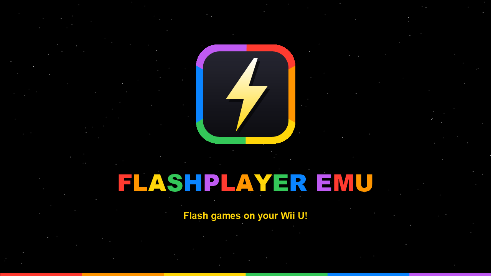
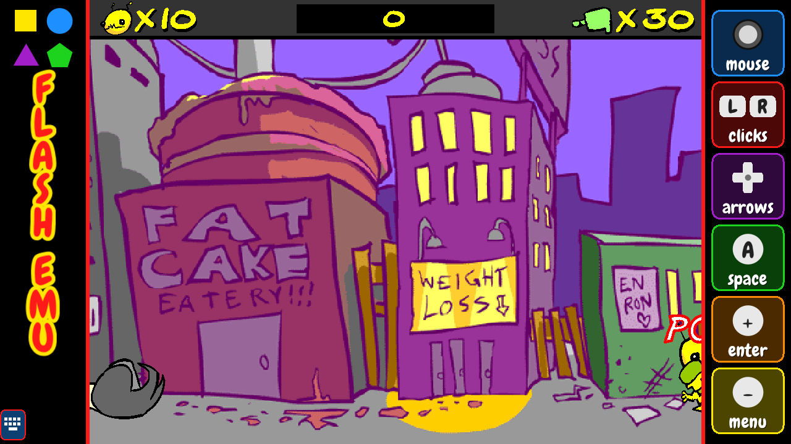
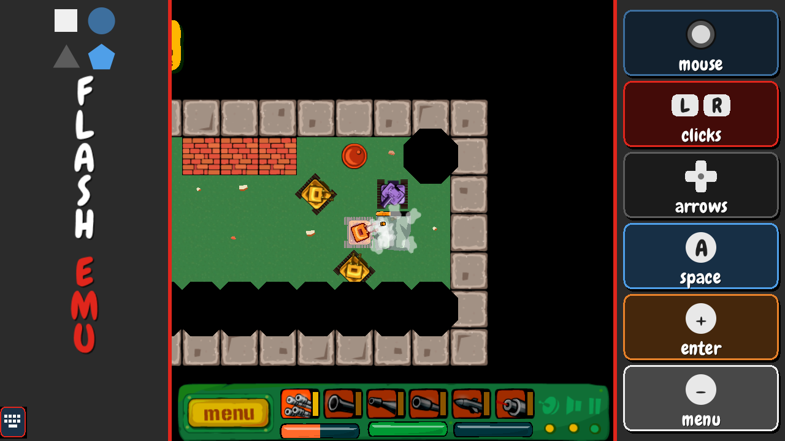
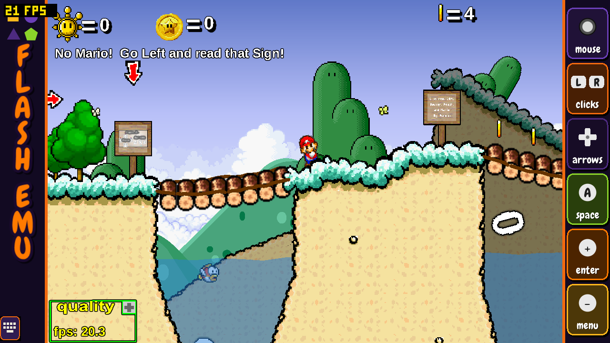

<p align="center">
  
</p>

<h1 align="center">Flashplayer Emu</h1>

<p align="center"><b>Flash games on your Wii U!</b><br>Wii U port by Charliebear31</p>

Flashplayer Emu plays Adobe Flash games (`.swf`) natively on the Wii U, with no PC or internet connection needed. It runs on [Ruffle](https://ruffle.rs), the open source Flash player, which is built for the console through WebAssembly and wasm2c.

**No games are included.** You supply your own `.swf` files.

## Screenshots

| Classic theme: Alien Hominid | Adobe Flash theme: Awesome Tanks | Halloween theme: Super Mario 63 |
| --- | --- | --- |
|  |  |  |

## Please read: not every game will work

**All games might not work.** We are working with 1 GB of DDR3, because that is all the Wii U can use for games. Very large Flash games can run out of memory, and demanding ones can run below full speed, because the Wii U has far less memory and CPU power than the PCs these games were made for.

Other known limits:

- Games can't go online: there are no network connections or sockets, so online features and games that download their content won't work.
- Camera and microphone aren't supported.
- Some less common parts of Flash are still missing or incomplete, such as per-element text rotation (right-to-left text is basic, and Arabic letters only join with a game's own embedded font), cube texture mipmaps, and Stage3D textures that only carry PVRTC or ETC data.
- Some Pixel Bender shaders don't draw correctly yet.
- Only one H.264 video can decode smoothly at a time, because each decoder needs about 40 MB.

## Features

### Flash support
- ActionScript 1, 2 and 3 games
- Vector shapes, bitmaps, gradients, masks and all the common blend modes
- Filters: blur, glow, drop shadow, bevel, gradient glow and bevel, colour matrix, convolution and displacement map, with the most common ones running on the GPU
- Stage3D (3D games), with shaders compiled on the console, including cube textures, mipmaps and ATF textures
- Works without the Armor Games and Kongregate online services, and without CPMStar ads: games that wait for those files still start, with scoreboards and logins turned off
- Text engine: line wrapping, mixed formats, baselines, justification, inline graphics, font metrics from the font file, mirror regions, right-to-left runs, fi/fl ligatures, joined Arabic letters, rotated lines
- BitmapData.perlinNoise runs natively on all three cores
- Pixel Bender shaders (partial)
- Video: H.263, VP6 and Screen Video, plus H.264 through the console's own decoder
- Game saves: each game's save data is kept on the SD card
- Device fonts for games that use system text
- Games can't open websites or links, and sitelocked games can be given the address they expect

### Menu
- Game grid with pictures taken automatically from each game
- Folders: drag one game onto another to make a folder, then rename it or reorder your games
- Three themes, each with its own music: **Classic**, **Adobe Flash** and **Halloween**
- Settings for theme, menu music volume, side borders, FPS counter and retaking game pictures
- Side borders with art and a controls guide, shown around games that don't fill the screen

### Controls
| Input | In games |
| --- | --- |
| GamePad touch screen | Mouse |
| D-pad / right stick | Arrow keys |
| Left stick | Moves a mouse arrow |
| L / R | Left / right click |
| A / B / X / Y | Space / Z / X / C |
| Plus | Enter |
| ZL / ZR | Shift / Ctrl |
| Minus | Back to the game list |

- **Wii Remote** with pointer, **Nunchuk**, **Classic Controller** and **Pro Controller** are supported through the same layout. These haven't been tested as much as the GamePad.
- **On-screen keyboard:** tap the small keyboard button at the bottom left of the GamePad to get every key a game might ask for. It stays on the GamePad and never appears on the TV.
- **System keyboard:** the Wii U's own keyboard opens when you tap a text box in a game. Wii Remotes and the other controllers can type on it too.

## How to install

1. Download `flashplayeremu.wuhb` from the [Releases](../../releases) page.
2. Copy it to `sd:/wiiu/apps/flashplayeremu/` on your SD card.
3. Put your games in `sd:/wiiu/apps/flashplayeremu/swf/`.
4. Start **Flashplayer Emu** from the Homebrew Launcher or the Aroma menu.

Games that come as a folder of files can be kept in their own folder, with all their files next to the `.swf`. A game saved together with its website also works: copy the whole folder into `swf/`, keeping the web page in it, and the game is found through that page.

For a sitelocked game, add a text file named `<game>.swf.url` next to it, containing the web address the game expects.

## Building from source

The build runs on Windows. It needs devkitPro with devkitPPC and wut, Rust with the `wasm32-wasip1` target, WABT (wasm2c), Java, LLVM with the wasm target, and CafeGLSL. See [ruffle-wiiu/NOTES.md](ruffle-wiiu/NOTES.md) for how the pieces fit together.

```powershell
.\ruffle-wiiu\tools\build-wiiu.ps1 -Configure
```

The scripts expect these tools in a `buildtools` folder next to `ruffle-wiiu`; `ruffle-wiiu/tools/env.ps1` lists them. Ruffle's large test suite is left out of this repository: get `tests/tests/swfs` from the Ruffle project if you want to run it.

## Credits

- **Wii U port:** Charliebear31
- **Flash engine:** [Ruffle](https://ruffle.rs) by the Ruffle contributors (MIT / Apache-2.0, see [its license](ruffle-wiiu/ruffle/LICENSE.md))
- **Classic theme music:** "Cipher" by Kevin MacLeod (incompetech.com), Creative Commons Attribution
- **Adobe Flash theme music:** "Sneaky Snitch" by Kevin MacLeod (incompetech.com), Creative Commons Attribution
- **Halloween theme music:** "Not As It Seems" by Kevin MacLeod (incompetech.com), Creative Commons Attribution
- **Tools and libraries:** wasm2c (WABT), devkitPro/wut, CafeGLSL by Exzap (MIT), minimp3 by lieff (CC0), libnds 8x8 font (zlib), Liberation Fonts (SIL OFL 1.1)

Flash games belong to their creators. This project isn't affiliated with Adobe or Nintendo.
